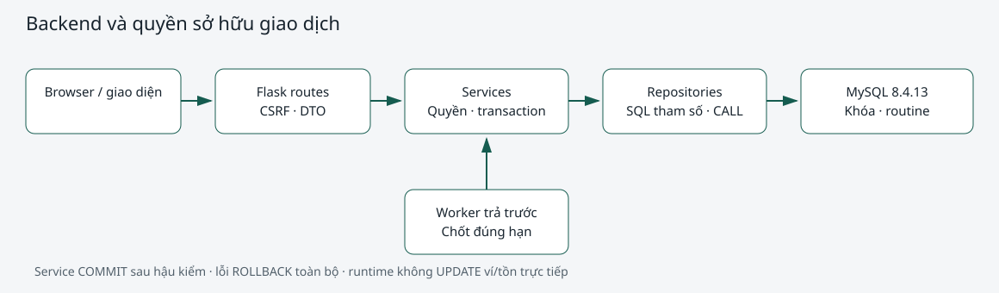

# Backend/API — Nguyễn Thành Đạt (2410709)

## Phạm vi và liên hệ BTL1

Hiện thực backend cho UC-02/03 (máy/phiên), UC-04 (đơn dịch vụ), UC-05 (ví), UC-06/07 (kho), UC-08 (báo cáo). Giữ baseline 23 bảng và tên cột nghiệp vụ; dùng SQL tham số, sáu procedure nghiệp vụ và ràng buộc/khóa để hỗ trợ BR-03/04/05/06/07/08/10/12/13 cùng báo cáo theo phạm vi demo. Không tuyên bố toàn bộ UC/BR đã có thao tác ghi.

Công nghệ thực kiểm tra: Python 3.12.3, Flask 3.1.3, mysql-connector-python 26.7.0 pure Python, Werkzeug 3.1.9, MySQL 8.4.13/InnoDB. Dependency có requirements.lock và requirements-dev.lock. Cài mới và lệnh demo ở [README backend](../../../apps/backend/README.md).

## Kiến trúc và trách nhiệm

Nguồn sửa sơ đồ: [backend_architecture.drawio](../../design/backend_architecture.drawio).

Flask phục vụ UI và /api/v1 cùng cổng 5000. Routes xác thực/CSRF, parse JSON/whitelist và HTTP; service kiểm tra quyền hiện tại, transaction, replay và thời điểm nghiệp vụ; repository SQL/CALL không commit. Runtime chỉ SELECT/EXECUTE/INSERT bốn bảng nháp, không UPDATE ví/tồn. Khóa hàng qua helper SQL SECURITY DEFINER với whitelist cố định; người cài đặt cấp quyền trong DB cho definer quan_net_owner. Có sáu procedure nghiệp vụ và hai procedure helper, hai hàm nghiệp vụ và hai hàm helper.

## API, quyền và đầu vào

Đủ 26 endpoint theo api_contract.md: 4 auth, 14 đọc, 8 ghi. Login dùng hash Werkzeug, không fallback mật khẩu plain text. Session đổi sau login, CSRF đổi theo; cookie HttpOnly/SameSite=Lax, Secure khi HTTPS. SECRET_KEY phải được cấu hình riêng. Backend đọc trạng thái/chức vụ từ DB mỗi request và kiểm tra lại trên kết nối ghi, không tin quyền cookie/body hoặc nhóm giá.

Người chơi chỉ truy cập tài nguyên mình; ThuNgan/QuanLy xử lý thu/nạp và phiếu nháp; PhaChe đọc/tiếp nhận đơn; chỉ QuanLy ghi sổ và xem báo cáo quản lý. Kiểm tra quyền trước replay để không trả đơn người khác. Body/Lines theo whitelist, ID/tiền/lượng đúng miền. JSON integer không nhận bool/float/chuỗi số; lỗi JSON là BAD_JSON. Thời gian serialize ISO +07:00 từ clock Asia/Ho_Chi_Minh.

Danh sách có giới hạn phân trang và sort whitelist; date pair đúng thứ tự, lọc khoảng cận trên loại trừ. Q05 không cộng nạp ví. Q07 tổng hợp phiếu và lượng bán riêng để không nhân bản số liệu. Q08 lấy ca giao khoảng ngày, chỉ so hai ca khác nhau của cùng nhân viên.

## Giao dịch, khóa và gửi lặp

Service sở hữu một kết nối +07:00/autocommit=False/READ COMMITTED. Xác thực DB, khóa, CALL/nháp, hậu kiểm và đọc DTO trong cùng transaction; commit xong mới trả thành công. Lỗi bất kỳ rollback toàn bộ và đóng kết nối, gồm lỗi đọc result-set. Routine không tự commit. Khóa theo ví → máy → phiên → đơn/phiếu → món tăng dần → giao dịch ví; tham số mã dùng ASCII/ascii_bin khớp cột khóa để tránh quét/khóa rộng do chuyển charset.

1213/1205 rollback toàn bộ rồi retry tối đa hai lần sau lần đầu, không retry lỗi nghiệp vụ. Lỗi UNIQUE mã nghiệp vụ cho phép chạy lại từ giao dịch mới và so quyền/nội dung đã lưu. Replay cùng nội dung trả 200/replayed; khác nội dung trả 409. Khóa nạp nap:{UUID}, thu giờ gio:{MaPhien}, thu món dv:{MaDonHang}; requestId chỉ để tra log. Không dùng cache RAM bảo đảm chống lặp.

Tạo đơn/phiếu nháp là thao tác đầu+dòng nguyên tử; chụp giá/tồn ở server. ThanhTien generated không được ghi trực tiếp. Tiếp nhận đơn trừ tồn một lần; thu đơn không trừ tồn lại. Ghi sổ phiếu kiểm kê đối chiếu ảnh tồn còn khớp, mọi thay đổi rollback nếu có dòng thất bại.

## Phiên trả trước và worker

Công thức tiền giờ: fee(t)=floor(t*g/3600). Với giá dương và ngân sách B, t_max=(3600*(B+1)-1)//g; SQL dùng DIV, không dùng phép chia DECIMAL rồi làm tròn. B=g=15.000 cho 3.600 giây. Giá 0 không giới hạn theo tiền và không chia 0.

Vãng lai dùng TienNapTruoc; hội viên dùng SoDuVi hiện tại vì chỉ có tối đa một phiên active/hội viên. TienGiuCho là phí đã phát sinh, được làm mới trước chi ví. Chi dịch vụ giảm ngân sách/hạn; nạp trước hạn tăng hạn. Nạp sau hạn quyết toán phiên cũ ở hạn cũ trước khi cộng tiền trong cùng transaction. Mọi thao tác dùng phiên kiểm tra hạn trên server dưới khóa.

Worker quét DB, rồi vào cùng service để khóa và tính lại hạn tại thời điểm thực hiện. Đóng tại min(giờ hiện tại,hạn), không tính thêm tiền do quét muộn. Ngữ cảnh hệ thống là capability nội bộ, actor SQL NULL; HTTP không tự chọn actor/giờ. Đọc DB để tái dựng hạn sau restart, không lệ thuộc timer trình duyệt hoặc hạn lưu RAM. Biên lai 0 đồng vẫn được tạo; không tạo giao dịch ví có số tiền 0.

## Kết quả kiểm chứng và minh chứng

Sau sửa review có **78 ca riêng biệt đạt**, không failure/error/skip: lượt chính 77 ca, lượt bổ sung 8 ca gồm 7 ca chạy lại. Các fixture dùng MySQL thật và tài khoản runtime hạn quyền. Lỗi commit/mạng và đếm retry có fault injection; 1213/1205, rollback và tranh máy/tồn/ví còn được kiểm chứng bằng hai kết nối thật. Không mô phỏng SQL/CALL bằng MockCursor.

Ba luồng HTTP test client được phân biệt với test Chrome thật. Test trình duyệt chạy UI → HTTP server → MySQL; dùng clock cố định riêng ca này để đối chiếu tiền xác định. D1 có biên lai và giải phóng máy; D2 nạp/gửi lặp, đặt/nhận/thu ví; D3 tạo/ghi sổ phiếu và xem báo cáo. Tồn 50→48→68, ví 100.000+100.000−30.000=170.000, doanh thu dịch vụ 30.000 không cộng nạp ví.

- [Tổng hợp kiểm chứng và lệnh tái hiện](../../../evidence/app/TD_repair_verification.md).
- [JUnit các ca riêng biệt](../../../evidence/app/TD_verified_results.xml).
- [Request/response thực đã bỏ bí mật](../../../evidence/app/TD_api_samples.json).
- [Kết quả Chrome](../../../evidence/app/TD_browser_three_flows.json) và [ảnh giao diện](../../../evidence/app/TD_browser_three_flows.png).

Trong mẫu thực, nạp 10.000đ trả 201, replay trả 200, đổi số tiền trả 409, gửi 1.9đ trả 422; số dư tăng đúng 10.000đ. RequestId và kết quả DB nằm trong JSON, không lưu cookie/CSRF/mật khẩu thật.

## Giới hạn và bàn giao

UI hiện là demo tích hợp cho phần TD; chưa xác nhận UI/báo cáo tổng hợp cuối của TT. SQL hỗ trợ backend đã cài mới được, chưa tự xác nhận toàn bộ tác vụ của MD/BD/HT. Chưa có API hủy/hoàn, thu công nợ trả sau hay CRUD tài khoản/danh mục/ca. Q07 phân nhóm bán theo ngày đặt vì baseline không lưu mốc tiếp nhận; không dùng nó chứng minh thời điểm xuất hàng khi đặt/nhận khác ngày. Các SQL quản trị ngoài API cần kiểm tra thêm theo toàn bộ BR.

Mô phỏng quyền dùng phiên, chưa khóa máy vật lý; một worker/process demo, không dùng Flask reloader. Chưa có migration cho database tự tạo trước đó. Review chéo trực tiếp với HT không được giả xác nhận; bộ cài/test/bằng chứng đã sẵn sàng cho bước này. Người trình bày cần giải thích một luồng ghi, một rollback dòng thứ hai, một replay và một ca tranh chấp bằng lệnh/test đi kèm.
